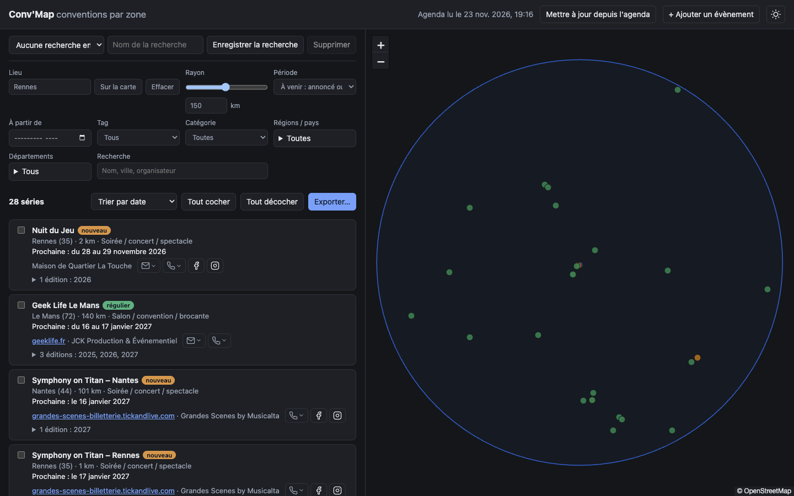
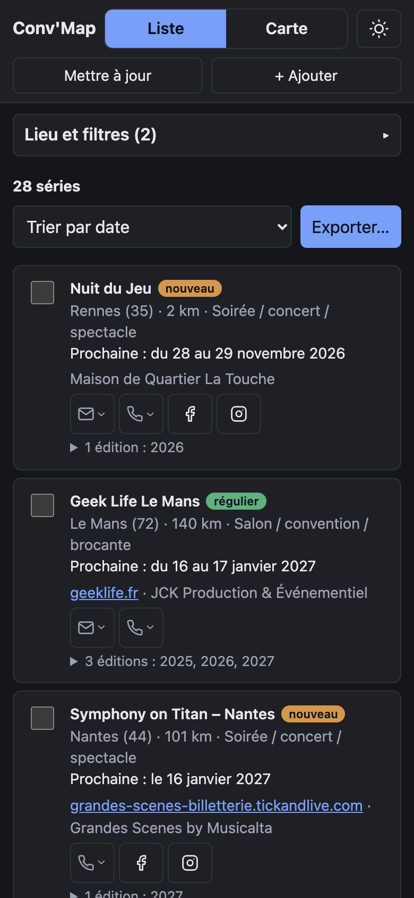

# Conv'Map

**Les conventions geek autour d'un lieu — passées, annoncées et probables.**

Conv'Map répond à une question que les agendas en ligne posent mal : *qu'est-ce
qu'il y a, et qu'est-ce qu'il y aura, dans un rayon donné autour d'ici ?* On
choisit un point et un rayon, ou des régions et des départements ; la page
regroupe les éditions d'un même évènement, repère ceux qui reviennent chaque
année et annonce un mois probable quand la prochaine date n'est pas encore
publiée.

Les évènements viennent de [L'Agenda Geek](https://lagendageek.com), qui les
recense et les tient à jour.



## Ce qu'on peut faire

- **Chercher par zone** — un lieu et un rayon, ou des régions et des
  départements, ou les deux.
- **Voir l'histoire d'un évènement** — une ligne par évènement récurrent, avec
  toutes ses éditions depuis fin 2022.
- **Savoir ce qui revient** — chaque évènement est marqué *régulier*,
  *nouveau*, *en pause ?* ou *ponctuel*.
- **Anticiper** — un évènement régulier sans date annoncée reçoit un mois
  probable, toujours signalé comme non annoncé.
- **Joindre les organisateurs** — site, e-mail, téléphone, Facebook et
  Instagram quand l'agenda les publie.
- **Emporter la liste** — cocher des évènements et les exporter en texte prêt
  pour un SMS ou un mail, en texte à coller dans un tableur, en Markdown ou
  en CSV.
- **Retrouver ses recherches** — lieu, rayon et filtres enregistrés sous un nom.
- **Compléter** — ajouter un évènement ou corriger une information, sans que
  la mise à jour suivante ne l'écrase.

Le tout sur ordinateur comme sur téléphone, en thème clair ou sombre.



## Y accéder

Le site est sur **https://convmap.suuuper.app**. Il s'ouvre avec un lien
d'accès personnel : la page et ce dépôt sont publics, mais les données
publiées avec le site sont chiffrées, et c'est le lien qui porte la clé. Sans
lien, la page ne montre aucun évènement.

Pour obtenir un lien, s'adresser à [meitogi](https://github.com/meitogi).

## Le faire tourner chez soi

Node 24 ou plus récent, aucune dépendance à installer.

```
npm start
```

Puis ouvrir http://localhost:4180 et cliquer **Mettre à jour depuis l'agenda**
(2 à 3 minutes la première fois). Cette version locale garde ses données dans
un fichier SQLite et ne demande aucun lien d'accès. `PORT=8093 npm start` pour
un autre port.

Dans un devcontainer qui ne relaie aucun port de lui-même, relayer le port à
la main : panneau « Ports » de VS Code > « Forward a Port » > 4180.

## Comment c'est fait

- Une page statique sans framework ; [Leaflet](https://leafletjs.com) pour la
  carte, rien d'autre.
- En local, un petit serveur Node (`node:http` + `node:sqlite`) ; en ligne,
  pas de serveur du tout : GitHub Pages sert la page, et ce que chacun ajoute
  reste dans son navigateur.
- Une copie de l'agenda est publiée avec le site, rafraîchie chaque semaine :
  la page s'ouvre aussitôt et fonctionne même quand l'agenda ne répond pas.
- Cette copie est chiffrée (AES-256-GCM). Chaque personne a son lien, qui se
  crée et se révoque depuis une page d'administration.

Pour aller plus loin :

- [docs/fonctionnement.md](docs/fonctionnement.md) — ce que fait la page en
  détail, les deux versions, les données, les accès, les limites ;
- [docs/mise-en-ligne.md](docs/mise-en-ligne.md) — publier le site sur son
  domaine, pas à pas.

## Tests

```
npm test
```

## Crédits

Conçu et développé par [meitogi](https://github.com/meitogi).

Les évènements viennent de [L'Agenda Geek](https://lagendageek.com) ; Conv'Map
n'en est qu'une autre façon de les parcourir. Pour annoncer ou corriger un
évènement à la source, c'est chez eux que ça se passe.

## Licences

Carte : [Leaflet](https://leafletjs.com) 1.9.4 (BSD-2-Clause, dans
`public/vendor/leaflet/`), fond de carte © les contributeurs d'OpenStreetMap. Icônes : tracés de
[Feather](https://feathericons.com) (MIT).
